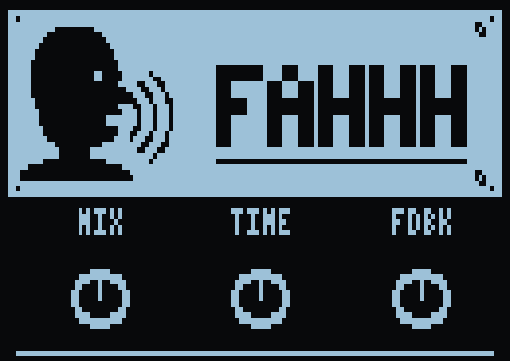

# Fahhh

A pick-triggered sampler for the MS-70CDR, in the spirit of Zoom's stock
Bomber: every note you pick fires the "Fahhh" shout. The shout can follow the
note you picked or keep its own pitch, and it has its own delay. The delay
repeats only the shout, never the guitar.

**Category: SFX** (group 7), next to Zoom's Bomber. It was the first of
this repo's effects in SFX and works there on the pedal; since 2026-11-11
Corrupt, Howl, Rewire, Shatter, Tonic and the screen effects are in SFX too.

**Status: runs on a pedal.** The 11,025 Hz build of 2026-11-09 (25,426
bytes) was loaded on the owner's MS-70CDR, where it shows in SFX and runs
(reported 2026-11-11; see [Next steps](#next-steps) for what is still to
check). The current `dist/Fahhh.ZDL` (28,226 bytes; code+data 25,826, so
3.7 KB under the size cap), built with TI CGT 8.5.0 on 2026-11-11, has the
shorter cut and stores the sample at 32 kHz (see [The sample](#the-sample)).
Its `.audio` is the same 6,016 bytes as the build that ran: only the
sample's length and rate and one filter coefficient changed. It has not been
on the pedal yet.

## Signal path

```
in ─┬───────────────────────────────────────────────────────── × (1-Mix) ─┐
    ├─ onset: fast env jumps over slow env, above the Sens floor ─ fire     + ─ out L/R
    └─ LP 1 kHz ─ ÷4 ─ ring ─ YIN, 8-45 ms after the pick ─ speed ─┐        │
                                                                   ▼        │
           sample: 2 voices, Hermite ─ LP 15 kHz ┬──────────── + ─ × Mix ──┘
                                                 └─ delay ─ LP ─ fb ─┘
```

* **Trigger.** A pick is a fast envelope (1 ms attack, 30 ms release) jumping
  past 1.8× a slow one (150 ms), above a floor set by Sens. Picks closer than
  80 ms apart count as one. A held note or chord fires once and does not fire
  again as it rings. A new pick restarts the sample, and the previous one fades
  out over 10 ms, so retriggering does not click.
* **Pitch (Note).** The guitar is low-passed, decimated to 11 kHz, and YIN
  runs on 23 ms of it starting 8 ms after the pick, so the attack is skipped. The
  search runs 5 lags per block, so no single block does all of it, and the
  pitch is known ~50 ms after the pick. The recording opens with the unpitched
  "F". Playback starts immediately at the previous note's speed and glides to
  the new one before the vowel arrives.
* **Retuning is varispeed,** like a sampler: a lower note plays the shout
  slower and longer. The speed ratio is folded by octaves into 0.5-2, which
  is the recording's own B3 ±1 octave (B2-B4). Notes in that range play
  exactly; a low E plays as E3 and a high E5 as E4, so the shout never lasts
  7 s and never turns into a chirp. On open strings the
  tracker reads 82.5 / 110.4 / 147.2 / 196.5 / 248.6 / 333.1 Hz (E A D G B E).
* **Delay.** It sits after the sample and before Mix. A picked note that is
  too light to fire never reaches it, so the dry is never delayed (a test
  checks this). The repeats are darkened and soft-clipped in the loop.
  Changing Time glides it, so turning the knob bends the echoes instead of
  clicking.

## Knobs

In menu order: page 1 is Mix, Time and Fdbk (the three on the cover), page
2 is Sens and Pitch.

| Knob | Range | Default |
|---|---|---|
| Mix | dry/wet, as in the rest of the pack; 0 passes the guitar unchanged | 50 |
| Time | 0 = no delay; then 20 ms … 1.2 s (quadratic, 50 = 315 ms) | 35 (165 ms) |
| Fdbk | delay feedback 0 … 0.92 | 40 |
| Sens | how light a pick still fires: 0 = hard picks only (−24 dBFS), 100 = the lightest touch (−54 dBFS) | 50 |
| Pitch | **Orig** (0): the recording's own pitch · **Note** (1): retuned to the note picked | Note |

The pedal shows "Orig" and "Note" for Pitch (`build/selector_metadata.py`,
the same mechanism as Stasis's Capture).

## Cover



The cover is the 🗣️ speaking-head emoji in pixel art, a bust in profile with
sound arcs coming out of its open mouth, beside FAHHH in the pack's block
lettering. It uses the light panel that Howl, Hydra and Gyre have, so the head
is dark, as in the emoji. It is drawn in
`src/airwindows/common/pack_covers.py` (with two screws in `lab_details.py`).
[graphics/fahhh.png](../../../graphics/fahhh.png) is rendered from that same
bitmap: there is no built ZDL yet for `make_gallery_png.py` to decode.

## The sample

[make_sample.py](make_sample.py) converts the recording into
[fahhh_sample.h](fahhh_sample.h). It takes 0.82-1.76 s of the source with a
200 ms fade-out, mixes it to mono, resamples it to 32,000 Hz, normalises it,
and stores it as 4-bit IMA ADPCM: 30,080 samples in 15,040 bytes. Those are
the script's defaults, so this regenerates the header as built:

```bash
python3 src/custom/fahhh/make_sample.py "Fahhhh - Sound effect (HD) - HighQualitySFX.mp3" \
    --preview previews/audio/fahhh_sample.wav
```

On the pedal, the first ~30 ms after load clear the delay line and decode
the sample into the ctx[3] arena in small chunks.

**The cut.** The source goes on to 3.04 s, but the owner heard two sounds
after the voice that are not part of it, and the cut ends before both:

* a steady tone at ~420 Hz, heard as "strings rising". It sits 17-20 dB
  under the voice's formants (1.2-1.5 kHz) until ~1.6 s, then climbs to
  within 4 dB of them by 2.04 s;
* a low rumble at 40-80 Hz. It starts rising at ~2.12 s, and from 2.24 s
  until the end it is louder than the voice.

A high-pass on the tail was tried instead, to keep the voice's natural
decay. It removes the rumble, but the outside sound also has energy at
250-700 Hz, which stays flat while the voice decays, so the cut won. With
the fade, the shout lasts 0.94 s; Time and Fdbk give it a tail back.
[fahhh_voice.wav](../../../previews/audio/fahhh_voice.wav) is the same cut
at the source's own quality (stereo, 44.1 kHz).

**The rate.** A ZDL must stay at or under 32,126 bytes, with code+data at
or under 29,576 (`build/zdl_size_guard.py`, and `build.py` runs it). The
first real build measured the effect without its sample at 10,786 bytes of
code+data, which leaves ~18.7 KB for the ADPCM. The MP3 has nothing above
16 kHz (−65 dB), so 32 kHz keeps everything the recording has, and a higher
rate would only add bytes:

| Rate | ADPCM | SNR | Audio up to |
|---|---|---|---|
| 11,025 Hz (the build that ran) | 5.2 KB | 20.8 dB | 5.5 kHz |
| 22,050 Hz | 10.4 KB | 25.9 dB | 11 kHz |
| **32,000 Hz** | **15.0 KB** | **28.8 dB** | **16 kHz, all of it** |
| 44,100 Hz | 20.7 KB | 31.7 dB | does not fit |

The rate costs no DSP time: playback is one Hermite interpolation per output
sample whatever the stored rate, and the decode at load does 256 frames a
block either way. `FH_OUT_LP` in `fahhh.c` was ~5 kHz for the 11 kHz sample;
it is ~15 kHz now, or it would throw the new top octave away. In Note mode,
notes above B3 play the sample faster, so its top can fold back down as a
faint hiss (−37 dB in the renders); if the pedal shows it, lower
`FH_OUT_LP`.

The recording itself is not in the repo. Only the encoded header is, so the
build does not need the recording. It is a downloaded sound effect: check its
licence before this ZDL goes into a public release.

The reference pitch for Note mode (`REF_HZ`, 243 Hz) was measured, not read
from the recording. The shout is breathy and has no steady fundamental. A
harmonic-sum search over the vowel keeps landing on 243 Hz, and the 5th and
6th harmonics (1216 and 1452-1474 Hz) carry most of the energy.

## Arena

About 385 KB of the pedal's 705,536-byte arena: state, a 1,024-point pitch
ring, the decoded sample (120 KB) and a 65,536-point delay line (1.49 s, of
which Time uses up to 1.2 s). If the arena is smaller, the effect passes the
input dry.

## Listening

These are desktop renders of this kernel, not pedal recordings. Input is at
25%, as in the other release samples:

| File | What |
|---|---|
| [fahhh_sample.wav](../../../previews/audio/fahhh_sample.wav) | the stored sample, decoded (what the ADPCM sounds like) |
| [fahhh_voice.wav](../../../previews/audio/fahhh_voice.wav) | the same cut from the source, stereo at 44.1 kHz, no coding |
| [fahhh_note.wav](../../../previews/audio/fahhh_note.wav) | defaults on [dry_guitar](../../../previews/audio/dry_guitar.wav): the six open strings, each retuned |
| [fahhh_orig.wav](../../../previews/audio/fahhh_orig.wav) | the same, Pitch on Orig |
| [fahhh_nodelay.wav](../../../previews/audio/fahhh_nodelay.wav) ([mp3](../../../previews/audio/fahhh_nodelay.mp3)) | the same, Time 0 |
| [fahhh_riff.wav](../../../previews/audio/fahhh_riff.wav) | defaults on [dry_riff](../../../previews/audio/dry_riff.wav): a pick every 250 ms |
| [fahhh_wet_echoes.wav](../../../previews/audio/fahhh_wet_echoes.wav) | Mix 100, Time 60, Fdbk 75: the shout and its echoes alone |

```bash
python3 tools/audio_preview/render_kernel.py src/custom/fahhh previews/audio/dry_guitar.wav out.wav \
    --set Pitch=0 --set Time=60 --set Fdbk=75
python3 -m unittest build/tests/test_fahhh.py
```

## Next steps

1. Built: `TI_ROOT=~/ti/ti-cgt-c6000_8.5.0.LTS python3 src/custom/fahhh/build.py`
   (`build.py` reads `TI_ROOT` and falls back to the macOS path). `.audio` is
   6,016 bytes, `.fardata` is 0, and there are no `.switch` sections, calls or
   indirect branches other than the two `B B3` returns. There are no undefined
   symbols, and Pitch's label callback is relocated at descriptor +0x24. The
   same checks pass on the 32 kHz build.
   `build_all.py fahhh` also works, but it rebuilds `tools/effects_db.json`
   from the local `build/probes/`, and on a machine without them it drops the
   probe entries.
2. Follow [SAFE-DSP-RULES](../../../docs/SAFE-DSP-RULES.md): load the smoke build
   first, then the full one. The smoke build is made by
   `python3 src/custom/fahhh/build.py --audio-nop` and written to
   `build/probes/fahhh-nop/Fahhh.ZDL` with its `.png`. It has the same name,
   group (SFX), ID and UI, and only its audio function returns at once, so the
   guitar passes dry. The two files differ in those 32 bytes only. With it,
   check that the pedal boots, that Fahhh is listed under SFX, the cover, both
   pages with Orig/Note, and no freeze on knob turns, page or patch changes and
   a power cycle. Then remove it from the pedal, write, and install
   `dist/Fahhh.ZDL`: Effect Manager does not replace an effect with the same ID.
3. Measure the declared DSP cost (40, an estimate) against the pedal's ~224
   limit. The YIN search is the peak: 1,280 multiply-adds a block for ~30
   blocks after each pick.
4. Check repeat98's FXID registry for 492 in the SFX group before flashing.
5. Listen on the pedal. These values were chosen from the desktop renders and
   need checking by ear: the shout's level (`FH_GAIN`), Sens's range, the
   ±1 octave fold, and the trigger ratio for fast picking.
